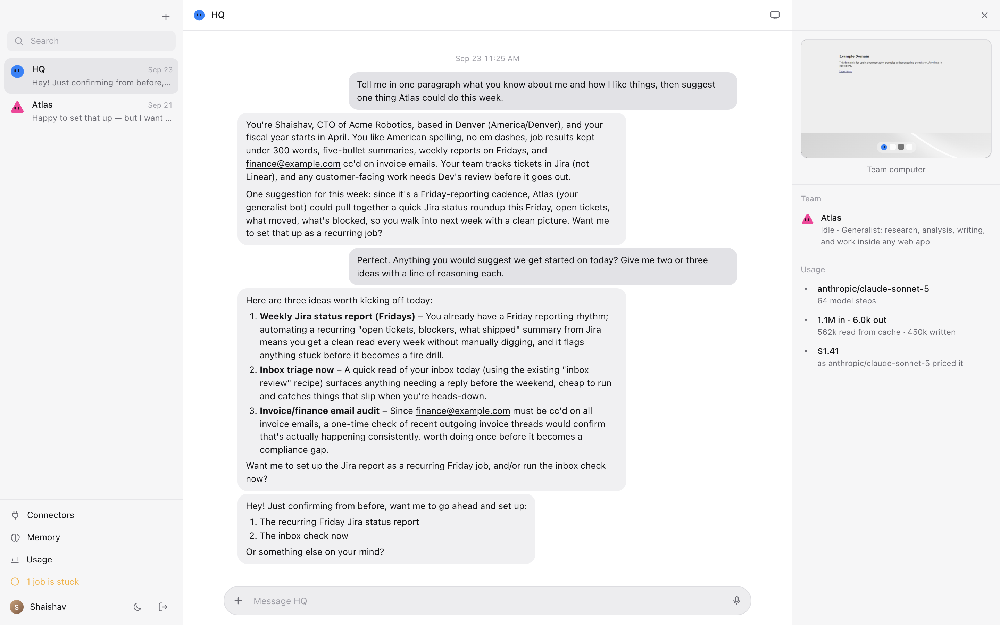
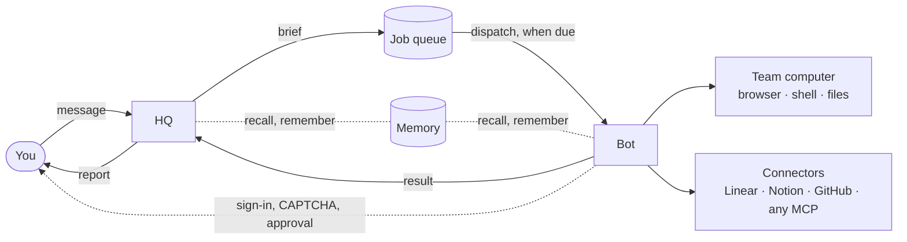
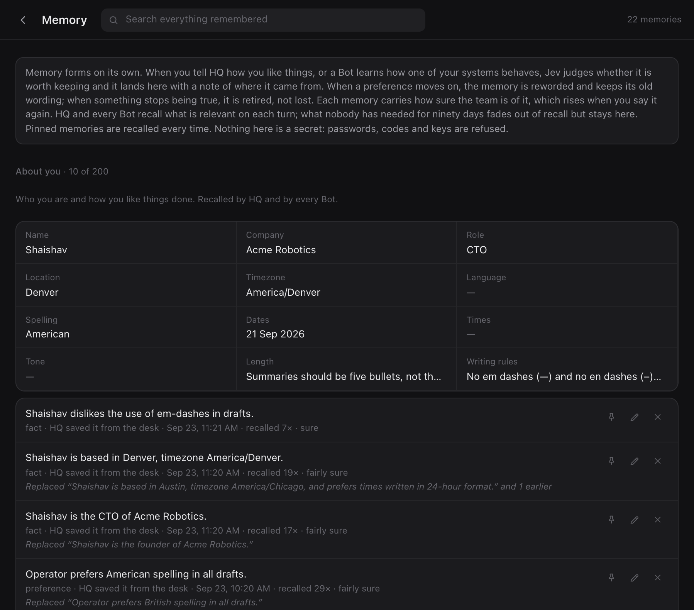

<p align="center">
  
</p>

<h1 align="center">EVE BOT</h1>

<p align="center">
  A team of always-on AI teammates with a computer of their own.<br>
  They work inside the apps you already use, keep going after you close the laptop,<br>
  and come back only when something needs your approval.
</p>

<p align="center">
  <a href="https://vercel.com/eve"></a>
  <a href="https://nextjs.org"></a>
  
  <a href="LICENSE"></a>
  
</p>

<p align="center">
  <a href="https://vercel.com/new/clone?repository-url=https%3A%2F%2Fgithub.com%2FShaivpidadi%2Feve-bot&project-name=eve-bot&repository-name=eve-bot&env=BOT_CONSOLE_TOKEN&envDescription=A%20long%20random%20password%20you%20sign%20in%20to%20the%20console%20with&envLink=https%3A%2F%2Fgithub.com%2FShaivpidadi%2Feve-bot%23vercel"></a>
</p>

<picture>
  <source media="(prefers-color-scheme: dark)" srcset="docs/images/console-dark.png">
  
</picture>

<p align="center">
  <a href="#quick-start">Quick start</a> ·
  <a href="#what-you-get">What you get</a> ·
  <a href="#the-console">The console</a> ·
  <a href="#safety">Safety</a> ·
  <a href="#keeping-it-up-to-date">Updates</a> ·
  <a href="#docs">Docs</a>
</p>

---

## How it works

You talk to **HQ**. HQ writes a brief, hands the job to the right **Bot**, and
reports back. The Bot does the work on the **team's computer**, a persistent
Linux machine with Chrome, a terminal, and files, and stops for you only when
a step needs a person: a sign-in, a CAPTCHA, an email about to go out.



Jobs survive restarts and redeploys. Memory forms on its own. Everything a Bot
does outwardly is fenced, logged, and gated on approval.

## Quick start

Same code, two homes.

| | Vercel | Standalone |
| --- | --- | --- |
| Setup | one click | `npm run setup` |
| The team's computer | Vercel Sandbox | Docker on your machine |
| Models | AI Gateway | Ollama, LM Studio, OpenRouter, any OpenAI-compatible API |
| Storage and memory | Vercel Blob | disk |
| Schedules | Vercel Cron | the server's own cron |
| Web search | eve's, through AI Gateway | your SearXNG, or Brave, Tavily, Exa |
| Costs | model usage at provider prices through AI Gateway, plus Sandbox and Blob on your Vercel plan | free with Ollama or LM Studio on your own hardware; per token on OpenRouter or any hosted API. Spend caps hold either way |

### Vercel

1. Click **Deploy with Vercel** above. It copies this repository to your
   GitHub, creates the project, and asks for one thing: `BOT_CONSOLE_TOKEN`,
   the password you sign in with (`openssl rand -base64 32` makes a good one).
2. Give it storage: in the project's **Storage** tab, create a Blob store
   (private access is fine), connect it to the project, and redeploy. The
   roster, jobs, and memory live there.
3. Open `/bot` on your deployment. Its setup page checks each step off until
   the console opens.

Prefer your Vercel login to a password? **Settings → Deployment Protection →
Vercel Authentication → All Deployments**. Standard Protection is not enough;
it leaves the production address public.

Hobby plans work. On Pro you can add a background worker (a
[Vercel Daemon](https://vercel.com/docs/daemons)) that does the watchdog's work
every 30 seconds, so due work, teammates' notes and idle browsers move with no
console open: see [docs/configuration.md](docs/configuration.md#the-background-worker).
It is not declared by default, because a daemon is billed for its memory
around the clock on Pro, working or not. Without it, `BOT_TICK_CRON="* * * * *"`
on Pro runs the watchdog every minute instead of daily.

### Standalone

Needs Node 24, Docker (Desktop, OrbStack, Colima, or a Docker host), and a
model endpoint that handles tool calls well.

```bash
npm install
npm run setup                 # pick Standalone; writes .env
npm run build && npm start    # http://localhost:3000/bot
```

`npm start` runs the agent and the console as one service, builds the
computer's Docker image from `agent/sandbox/Dockerfile` on first run (a few
minutes, with Chrome and a small desktop), and stops the computer when it stops. Keep `.data/`,
`.eve/.workflow-data/`, and the `bot-computer` Docker volume on storage that
survives a restart.

Or as containers, with a SearXNG for search and an optional Ollama:

```bash
npm run setup
docker compose up -d --build                     # add --profile ollama for a model server
```

In `.env`, address other services by name, not `localhost`: a model server on
the machine itself is `http://host.docker.internal:11434/v1`, the profile's
Ollama is `http://ollama:11434/v1`.

## What you get

| | |
| --- | --- |
| **HQ** | The teammate you message. It writes a brief with success criteria, hands the job to the right Bot, and reports back. It does no work itself. |
| **Bots** | Each has a name, a job, a persona, a playbook it learns, and its own thread. Every workspace starts with Atlas, a generalist. Work goes to whoever you tag (`@Ava`), else the Bot whose role fits it, else HQ, which does work itself too. Bots can message each other, and the answer comes back to the thread that asked. |
| **One computer, kept** | A persistent Linux machine with one Chrome, a terminal, and files, shared by the whole team. Sign-ins carry across Bots. Backed up while Bots work, restored if it is ever replaced. |
| **Watch and take over** | The screen sits in every thread. When a Bot hits a sign-in, a code, or a CAPTCHA, it asks you; you do the step in its live browser and hand back. Passwords go into the page, never through chat. |
| **Durable jobs** | A run survives restarts and redeploys, waits for its start time with no compute, renews a lease so a dead run is noticed, and can park a day for your sign-off. A watchdog re-dispatches anything stranded, and the next run continues from the job's journal instead of starting over. |
| **Rewind** | Every job keeps a journal of what it did. Take a job back to any step from its thread: its files come back as they were, and a fresh run carries on from there. Emails already sent stay sent, and the run is told so. |
| **Approvals** | Sending email, retiring a Bot, any connector tool that changes something, and any browser click that could send, spend, delete, or save stop for a person first. |
| **Memory** | The team remembers on its own, workspace-wide, with confidence, history, and fading. Preferences about how you want things written hold in every reply. [More below.](#memory) |
| **Connectors** | Linear, Notion, Atlassian, and Sentry with one click through their own OAuth. GitHub and any MCP server by address. Every tool has a switch and a read-or-change tag. [More below.](#connectors) |
| **Budgets** | A monthly and daily cap on model spend for the whole workspace, with the computer's runtime counted once you set its rate. A run that would not fit is blocked with the reason. |

### Memory



After each exchange with HQ, and after each job, Jev judges whether anything
said is worth keeping, a small model phrases it, and it lands in one of three
shared slots: about you, your team, how to do your work.

- **Fields, not sentences.** Name, company, timezone, date and time formats,
  spelling, who approves what, where tickets live: one current value each, so a
  change is an overwrite with history rather than a second sentence.
- **Learns from what you do.** A job sent back with a note, and an action you
  decline when a Bot asks first, go through the same gate. What you forget by
  hand stays forgotten.
- **Confidence and fading.** Each memory carries how sure the team is of it,
  rising when you say it again. What nobody has needed for ninety days fades
  out of recall but stays on the page.
- **Ranked by meaning.** On the Gateway the Bots' lessons carry a small
  embedding each, so "the export drops rows" is found for "CSV loses data".
  Elsewhere, by words.
- **Style that holds.** How you want things written (spelling, dates, tone,
  length, rules such as "no em dashes") reaches HQ and the Bots as
  instructions on every turn, so it holds in chat replies as well as drafts.

Open **Memory** in the console to search it, pin what should always be
recalled, correct it, bring a retired memory back, or forget it.

### Connectors

Connect Linear, Notion, Atlassian, or Sentry with one click and no setup: the
server signs you in through its own OAuth, this app registers itself as a
client, and the token is kept sealed per workspace so every Bot and every
routine can use it. GitHub and a documentation source are added by name, and
any MCP server by address; a custom server that needs OAuth is detected when
it is added.

On Vercel, a connector can sign in through [Vercel Connect](https://vercel.com/docs/connect)
instead: make one with `vercel connect create linear --name acme-linear` and
`vercel connect attach linear/acme-linear`, then add a custom server with
**Sign in through Vercel Connect** and that UID. Vercel keeps the token (none
is stored, exported or backed up here), one sign-in serves the workspace, and
signing out from the connector's page ends the grant at Vercel too. Grants
belong to one environment: a production sign-in is not seen by previews or
`vercel dev`.

Each connector has its own page: its account, every tool with a switch and a
read-or-change tag, when a person is asked first, and the facts about it.
Tools that change something ask first, and HQ only uses the reads a person
confirmed. When a Bot needs an account nobody has connected yet, the thread
says so with a button to the Connectors page, and the work carries on once it
is connected.

## The console

`/bot`: your Bots on the left, the selected thread in the middle, the team's
screen and the Bot's routines on the right. Right-click a Bot, or use the **⋯**
on hover, for its menu: pin, move to a section, mark unread, clear chat,
rename, edit profile, duplicate, hide, delete.

- **Usage, Memory, Models, and Connectors** open as sheets over the console, so the
  conversation stays in view. Usage shows the workspace's spend: the total,
  the last seven days, a bar per day, and tables by model, by who ran it, and
  job by job, with the price the provider reported. Off AI Gateway set
  `BOT_MODEL_PRICES` to see dollars instead of zeros.
- **Models.** Pick the AI Gateway model for HQ, each kind of Bot job, and the
  helper, from Gateway's list (free ones first, paid ones with their prices)
  or by name. One switch puts the whole team on free models.
- **Budget.** The card on the Usage sheet is the workspace's limit for the
  month and the day. Everything that calls a model draws on it.
- **Who is signed in.** Behind Vercel Authentication the console shows your
  Vercel name and picture. Elsewhere, click the sidebar's footer to set a
  name; HQ and the Bots use it too.
- **Self-healing threads.** A thread that accepts a message and never answers
  is moved to a fresh session after about a minute, the message is sent again,
  and the thread says so. The new session knows what is in Memory.
- **Update now** appears in the footer when a newer version is out.

Opening the console from another device over plain http puts the browser in an
insecure context, and the live screen will not connect. Use `npm run dev:https`,
or on a standalone server set `BOT_COMPUTER_LOCAL_BIND=0.0.0.0` and serve over
http, or put the gateway behind TLS.

## Safety

What stops a Bot from doing something nobody meant:

- **Run fencing.** One run per job, holder of its lease. Every write and every
  outward action checks the session still holds it. A run that lost its lease
  or whose job was cancelled is refused, even with an approval in hand.
- **Cancellation that sticks.** Stop in the console or from chat: actions are
  refused at once, shell commands are killed, the Bot stops before its next
  model call, and nothing can mark the job done afterwards.
- **A gate on every click.** Clicks, Enter, selections, and uploads are
  classified first, and each click runs with a network guard that turns any
  POST the page makes into an approval request. Approvals are bound to the
  exact page and element.
- **Connectors re-read on every call.** Switching a tool off or rotating a key
  bites on the next call. Approvals stop counting once settings change.
- **Email through a ledger.** Every send is recorded before it goes, with an
  idempotency key the relay must honour.
- **A fenced shell.** Commands run as an unprivileged user behind a network
  fence; they cannot reach the browser, the team's sign-ins, or the gateway key.

The full model, with what it does not catch, is in [docs/safety.md](docs/safety.md).

## Keeping it up to date

A deployment made with the Deploy button updates itself: its **Sync with
upstream** workflow checks once a day for a new release and, once a release is
six hours old, merges it into your copy, and Vercel deploys it. The console
says when a newer version is out. With a GitHub token saved in Settings
(Updates), **Update now** in the sidebar's footer updates it on the spot;
without one it opens the workflow to run. Standalone, update the way you
installed:

```bash
git pull && npm install && npm run build && npm start     # or: docker compose up -d --build
```

Stored data is carried forward across versions. Copies made before the
workflow existed need one manual sync; see [docs/updating.md](docs/updating.md),
which also lists what each release asks of you.

## HTTP

Everything the console does goes through `/bot/v1`, so anything else can too.
Send `Authorization: Bearer <console token>`. The same gate guards every
route: without the token, or Vercel's sign-in in front, a request gets a 401,
and a deployment with neither configured refuses to serve at all. The token
is the whole secret, so treat it like a password.

```bash
curl -X POST localhost:3000/bot/v1/rooms/desk/messages -H 'content-type: application/json' -d '{"message":"Who is on the team?"}'
curl -N 'localhost:3000/bot/v1/rooms/desk/stream?startIndex=0'          # NDJSON, live
curl localhost:3000/bot/v1/state                                          # roster, presence, feed
```

The rest, approvals, Bots, jobs, connectors, and the agent-readable front
door, is in [docs/http.md](docs/http.md).

## Docs

| | |
| --- | --- |
| [Configuration](docs/configuration.md) | every variable, the outbound email relay contract, and how the Bots' shell is fenced |
| [Safety model](docs/safety.md) | run fencing, cancellation, the browser gate, connectors, budgets, and the limits |
| [Keeping it up to date](docs/updating.md) | the sync workflow, manual syncs for older copies, moving a workspace between Vercel and your machine, and what each release asks of you |
| [HTTP API](docs/http.md) | the console API, with curl examples |
| [Development](docs/development.md) | running it locally, the layout, Jev, metrics, and the QA suite that drives a deployment |
| [Decisions](docs/decisions) | design records, starting with the state store |

## Development

```bash
npm run dev          # console and agent together
npm test             # vitest
npm run typecheck && npm run build
```

Built on [eve](https://vercel.com/eve) and Next.js. More in
[docs/development.md](docs/development.md).

## License

MIT. See [LICENSE](LICENSE).
